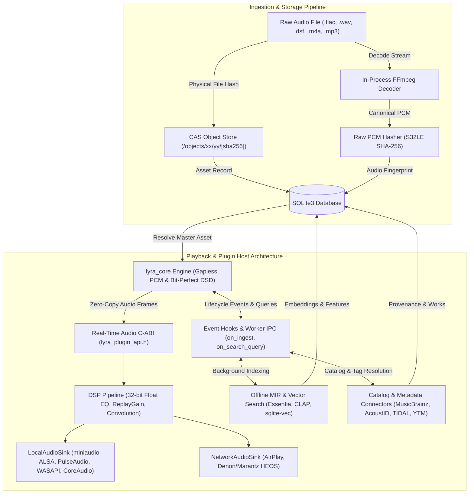

<!--
SPDX-FileCopyrightText: 2026 Tzu-Ting Lin

SPDX-License-Identifier: AGPL-3.0-or-later
-->

# Lyra

> Local-first music library manager and audio player with a C++20 core, immutable file storage, and an extensible plugin system.

---

Lyra is a music library manager and audio player built for people who maintain their own music collections. Most players treat a library as a flat folder of files with fragile metadata tags, which falls apart once you collect multiple masters, remixes, covers, and soundtrack editions of the same composition. Lyra separates compositions from recordings and physical files, keeps your original audio untouched on disk, and uses a modular plugin system for semantic audio search, streaming integrations, and lossless network playback.

---

## Why Lyra?

### 1. Group Covers, Remixes, and Re-Releases Under One Work

Standard music players scatter your library whenever you own five versions of the same song, such as the studio original, an acoustic take, a club remix, a nightcore edit, and a live recording.

Lyra models your catalog across four distinct layers so variations stay connected without hiding the specific recording you want to hear:
* **Work**: The underlying composition (for example, Mozart's *Queen of the Night*, or a modern song).
* **Track**: A specific recording, cover, remix, or arrangement linked to that Work.
* **Audio**: The distinct sound wave itself. When you have multiple encodes or masters of the same recording, Lyra compares sample rate, bit depth, and format to pick the cleanest master by default while keeping alternate versions one click away.
* **Asset**: The actual file on disk (`.flac`, `.wav`, `.dsf`, `.m4a`, `.mp3`).

```text
Work: "Queen of the Night"
  ├── Track A (Original Studio Recording)
  │     ├── Audio 1 (24-bit / 96 kHz Hi-Res FLAC) ★ Recommended Master
  │     │     └── Asset (file_a.flac)
  │     └── Audio 2 (16-bit / 44.1 kHz ALAC)
  │           └── Asset (file_b.m4a)
  ├── Track B (Movie Soundtrack Version)
  │     └── Audio 3 (16-bit / 44.1 kHz WAV)
  │           └── Asset (file_c.wav)
  ├── Track C (DJ Club Remix)
  │     └── Audio 4 (320 kbps MP3)
  │           └── Asset (file_d.mp3)
  └── Track D (Acoustic Cover)
        └── Audio 5 (16-bit / 44.1 kHz FLAC)
              └── Asset (file_e.flac)
```

### 2. Stop Duplicating Files and Corrupting Tags

Editing ID3 or Vorbis tags directly inside audio files mutates their binary contents, which alters file checksums and triggers unnecessary re-uploads across backup tools like Restic, Borg, or rsync. Worse, buggy taggers occasionally corrupt headers or strip embedded artwork.

Lyra treats your source audio files as read-only historical artifacts and stores all metadata inside a local SQLite database instead. When you import files, Lyra deduplicates identical copies at the storage layer so compilation albums and single releases share the same bytes on disk. Because it hashes the decoded sound wave rather than relying on filenames or container headers, Lyra recognizes a `.flac` and an uncompressed `.wav` from the exact same master as the same audio.

### 3. A Plugin System for Search, Streaming, and Audio Processing

A core audio engine should stay small and predictable instead of bundling every network protocol or machine learning runtime into the main binary. Lyra exposes a clean plugin interface so heavy or external workflows run as modular extensions:

* **Find tracks by how they sound, offline**: Tags rarely capture mood or instrumentation across a 10,000-track library. An optional indexing plugin runs local audio models on your own GPU or CPU to extract tempo, musical key, and acoustic embeddings, letting you type queries like *"slow synthwave with heavy bass and no vocals"* without sending a single byte to the cloud.
* **Send lossless audio straight to living room amplifiers**: You shouldn't have to leave a noisy desktop PC running just to feed an optical cable into your stereo receiver. Network sink plugins stream decoded PCM audio over your local network directly to Apple AirPlay receivers and Denon/Marantz HEOS amplifiers.
* **Unify local files with streaming catalogs**: Provider plugins connect external catalogs (YouTube Music, TIDAL, Apple Music) and metadata databases (MusicBrainz, AcoustID, Discogs) into the same Work and Track hierarchy as your local files.
* **Shape your output signal**: Inline audio processing plugins handle parametric EQ, loudness normalization, and room correction filters before audio reaches the output device.

---

## Architecture at a Glance



* **Core (`core/`)**: Written in C++20. Uses `SQLite3` for metadata and relationship storage, in-process `FFmpeg` (`libavformat` / `libavcodec` / `libswresample`) for decoding and `S32LE SHA-256` acoustic fingerprinting, and `miniaudio` for cross-platform hardware output.
* **Interface & Plugin Architecture (`ui/` & Plugins)**:
  * **UI Boundary**: Exposes a stateless C-ABI (`lyra_c_api.h`) for the Flutter desktop and mobile client (`dart:ffi`).
  * **Real-Time Audio Plugins (`lyra_plugin_api.h`)**: In-process C-ABI for latency-critical audio sinks and inline DSP processors.
  * **Event Hooks & Background Workers**: Out-of-process IPC hooks (`on_ingest`, `on_search_query`) so heavy Python/ONNX audio models (`CLAP`, `Essentia`, `Whisper`) and network scrapers run in isolated worker processes without bloating or crashing the core engine.

---

## Roadmap

### Core Foundation (Completed)
- [x] Content-Addressable Storage (CAS) physical file deduplication (`/objects/xx/yy/[hash]`)
- [x] In-process FFmpeg decoding and raw PCM acoustic fingerprinting (`S32LE SHA-256`)
- [x] Single-level star topology for audio versions with automated master quality ranking
- [x] Double-buffered gapless playback engine with `miniaudio` local output (`LyraAudioSink` C-ABI)
- [x] Cross-platform Flutter desktop client foundation and interactive CLI (`lyra-cli`)

### Core & Mobile (Planned)
- [ ] **Plugin Host & Event Hook System**: Real-time C-ABI for audio sinks/DSP alongside out-of-process event hooks for background AI indexers and catalog providers
- [ ] **DSD Audio Support (`.dsf` / `.dff`)**: DSD container ingestion, high-precision DSD-to-PCM conversion, and bit-perfect **DoP (DSD over PCM) / Native DSD** passthrough to hardware DACs
- [ ] **Automatic Cover & Remix Grouping**: Automatically link covers, remixes, and live versions under the same musical `Work` during import, plus file provenance tracking (`Source_Data` origin and URL history)
- [ ] **Mobile Client Adaptations**: iOS and Android UI layouts

### Official Plugins (Planned)
- [ ] **Offline MIR & Semantic Audio Search**: Local acoustic feature extraction (BPM, musical key, mood, and instrument tagging via `Essentia` / `PANNs`) and natural-language text-to-audio vector search (`CLAP` embeddings indexed in `sqlite-vec`, with optional local LLM query expansion)
- [ ] **Network Audio Sinks**: Lossless LAN streaming to Apple AirPlay and Denon/Marantz HEOS (`LyraAudioSink`)
- [ ] **Music Provider Connectors**: Unified catalog and playback integration for YouTube Music, TIDAL, and Apple Music
- [ ] **Metadata & Acoustic ID Enrichment**: Automatic cover and remix relationship resolution via AcoustID, MusicBrainz, and Discogs
- [ ] **Offline Lyrics & Vocal Transcription**: Synced `.lrc` fetching and local vocal-to-lyric alignment via Whisper for full-text lyric search
- [ ] **DSP & Room Correction Pipeline**: Inline 32-bit float parametric EQ, ReplayGain / EBU R128 loudness normalization, and convolution filters before sink output
- [ ] **Listen History & Scrobbling**: Optional playback syncing with ListenBrainz, Last.fm, and local listening analytics

---

## Getting Started & Development

Lyra uses **Nix** for reproducible build and test environments across Linux and macOS. Make sure Nix is installed with `nix-shell` available.

### Build the C++ Core & CLI
```bash
./build.sh
```

### Run Automated Tests
Runs both C++ unit tests and Python FFI integration tests:
```bash
./test.sh
```

### Run the Flutter Desktop Client
```bash
./flutter.sh pub get
./flutter.sh run -d linux
```

---

## License

Lyra uses a dual-licensing model:

1. **Community Edition (Open Source)**: Licensed under the **GNU Affero General Public License v3.0 or later (`AGPL-3.0-or-later`)** for personal use, academic work, and open-source distributions.
2. **Commercial Edition**: Required if you distribute Lyra inside proprietary commercial hardware, embedded audio appliances, or closed-source services without complying with `AGPL-3.0-or-later` source disclosure terms.